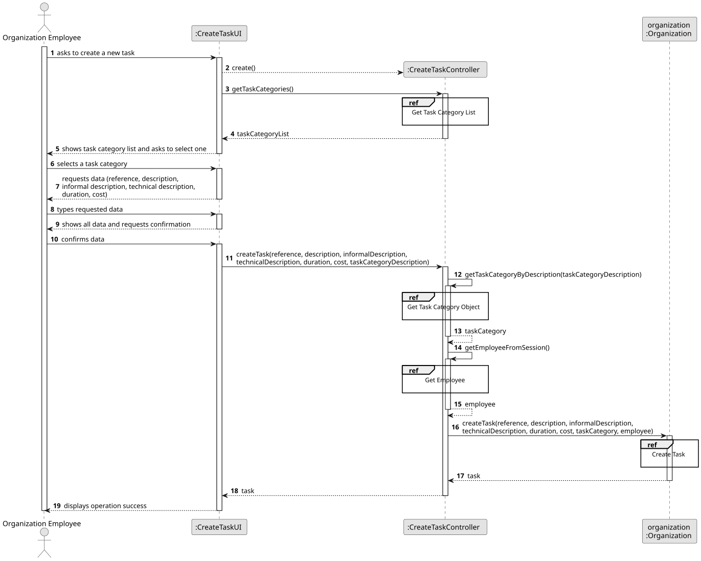

# US001 - Create a Map

## 3. Design

### 3.1. Rationale

| Interaction ID | Question: Which class is responsible for...           | Answer              | Justification (with patterns)                                                                                         |
|:---------------|:------------------------------------------------------|:--------------------|:----------------------------------------------------------------------------------------------------------------------|
| Step 1         | ... interacting with the actor?                       | CreateMapUI         | Pure Fabrication: no existing domain class is responsible for interaction; UI class handles user-facing interactions. |
|                | ... coordinating the US?                              | CreateMapController | Controller                                                                                                            |
|                | ... knowing the user using the system?                | Editor              | IE: knows its own data (e.g. username, password)                                                                      |
| Step 2         | ... requesting the map name and size?                 | CreateMapUI         | IE: responsible for managing the user input flow.                                                                     |
| Step 3         | ... saving the inputted map data (name and size)?     | CreateMapUI         | IE: responsible for temporarily storing data until confirmation.                                                      |
| Step 4         | ... confirming user input and submitting the request? | CreateMapUI         | IE: is responsible for user interactions.                                                                             |
| Step 5         | ... checking if a map name already exists?            | MapRepository       | IE: responsible for managing persistence and access to stored Maps.                                                   |
| Step 6         | ... creating a new Map?                               | Map                 | Creator: the Map class is the one whose instances are being created.                                                  |              
| Step 7         | ... saving the newly created Map?                     | MapRepository       | IE: responsible for persisting domain entities.                                                                       |
| Step 8         | ... informing operation success?                      | CreateMapUI         | IE: responsible for output to the actor (Editor).                                                                     | 

### Systematization ##

According to the taken rationale, the conceptual classes promoted to software classes are: 

* Map

Other software classes (i.e. Pure Fabrication) identified: 

* CreateMapUI
* CreateMapController
* Employee

## 3.2. Sequence Diagram (SD)

### Full Diagram

This diagram shows the full sequence of interactions between the classes involved in the realization of this user story.

### Split Diagrams

The following diagram shows the same sequence of interactions between the classes involved in the realization of this user story, but it is split in partial diagrams to better illustrate the interactions between the classes.

It uses Interaction Occurrence (a.k.a. Interaction Use).

**Get Task Category List Partial SD**

**Get Task Category Object**

**Get Employee**

**Create Task**

## 3.3. Class Diagram (CD)

