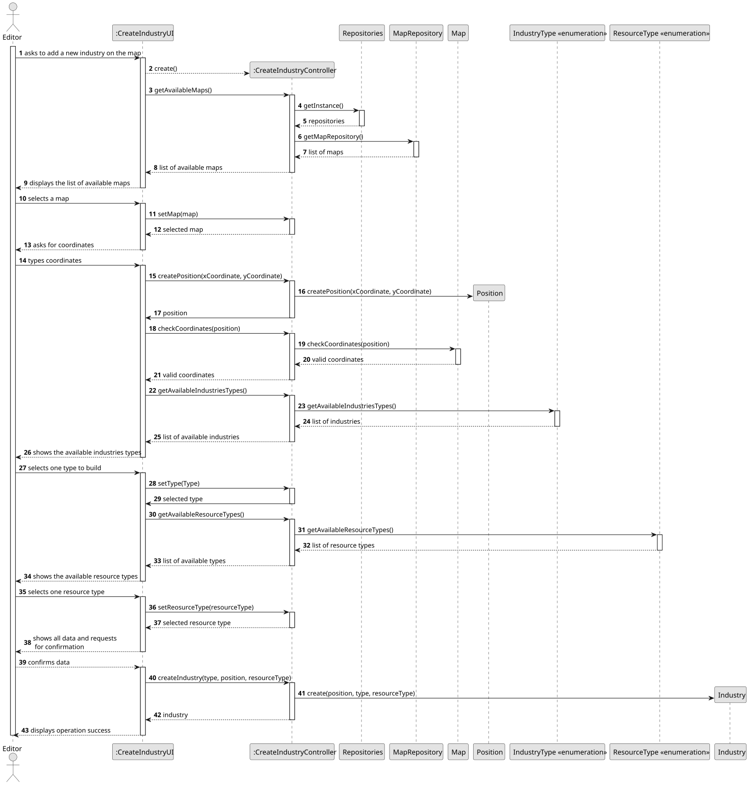
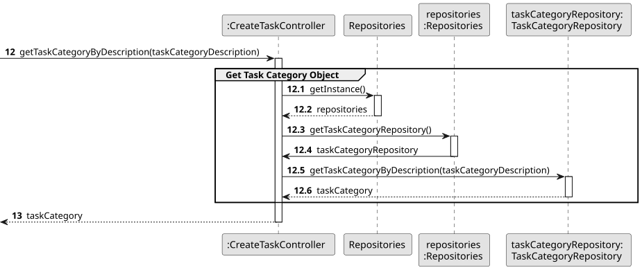
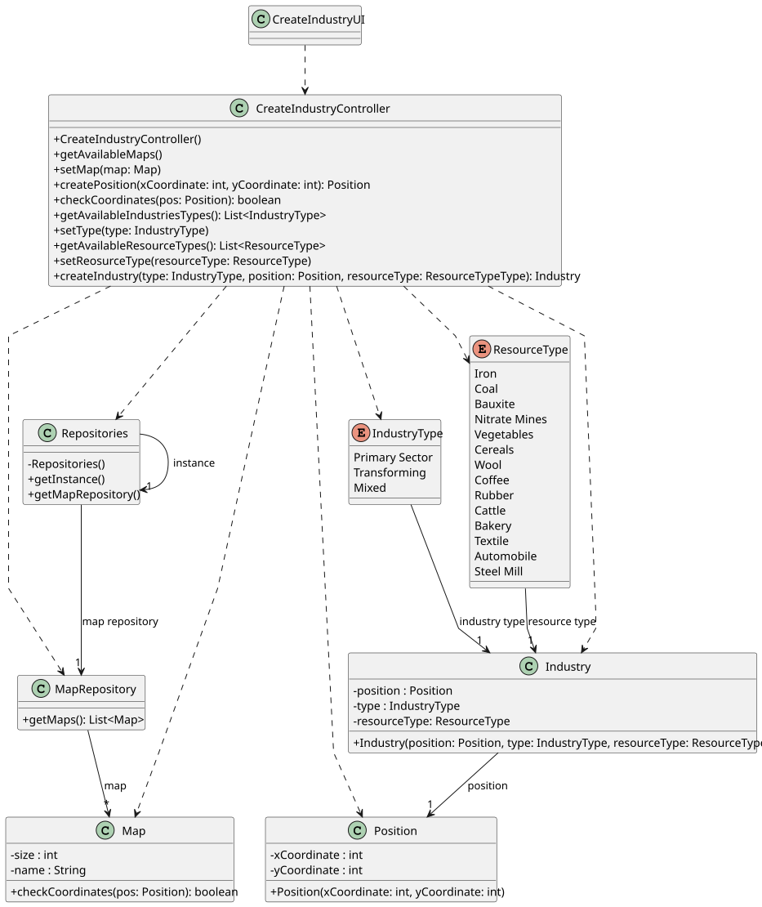

# US002 - Place an Industry

## 3. Design

### 3.1. Rationale

| Interaction ID | Question: Which class is responsible for...       | Answer                   | Justification (with patterns)                                                                        |
|:---------------|:--------------------------------------------------|:-------------------------|:-----------------------------------------------------------------------------------------------------|
| Step 1         | ... interacting with the actor?                   | CreateIndustryUI         | Pure Fabrication: UI handles user interaction but is not a domain class.                             |
|                | ... coordinating the US?                          | CreateIndustryController | Controller: Coordinates the use case by delegating responsibilities to domain or fabricated classes. |
|                | ... knowing the user using the system?            | Editor                   | IE: knows its own data (e.g. username, password).                                                    |
| Step 2         | ... knowing all existing maps to show?            | Repositories             | IE: Central access point to various repositories.                                                    |
| Step 3         | ... saving the selected map?                      | CreateIndustryUI         | IE : Stores temporary user input.                                                                    |
| Step 4         | ... requesting coordinate input?                  | CreateIndustryUI         | IE: Responsible for handling user interactions.                                                      |
| Step 5         | ... saving the coordinates?                       | CreateIndustryUI         | IE: Temporarily stores input for further use.                                                        |
| Step 6         | ... validating coordinates?                       | Map                      | IE: Owns map data and knows which coordinates are valid.                                             |
| Step 7         | ... knowing all industry types?                   | IndustryType             | IE: Enum holds all predefined types; behavior is fixed and central.                                  |
| Step 8         | ... saving the selected industry type?            | CreateIndustryUI         | IE: Temporarily holds input from user.                                                               |
| Step 9         | ... knowing all resource types?                   | ResourceType             | IE: Enum represents a fixed list of options, centralizing responsibility.                            |
| Step 10        | ... saving the selected resource type?            | CreateIndustryUI         | IE: Responsible for holding the resource type selected by the user.                                  |
| Step 11        | ... showing all data and requesting confirmation? | CreateIndustryUI         | IE: Responsible for interacting with the actor.                                                      |
| Step 12        | ... instantiating a new Industry?                 | Industry                 | Creator: Industry class is the best candidate to create its instances.                               |
|                | ... validating all data (local validation)?       | Industry                 | IE: Owns its data and can validate its own invariants.                                               |
|                | ... saving the created industry?                  | Map                      | IE: Map aggregates Industries and is responsible for managing them.                                  |
| Step 13        | ... informing operation success?                  | CreateIndustryUI         | IE: Responsible for feedback to the user.                                                            |

### Systematization ##

According to the taken rationale, the conceptual classes promoted to software classes are: 

* Map
* Industry
* Position
* Industry Type
* Resource Type

Other software classes (i.e. Pure Fabrication) identified: 

* CreateIndustryUI  
* CreateIndustryController
* Repositories
* MapRepository

## 3.2. Sequence Diagram (SD)

### Full Diagram

This diagram shows the full sequence of interactions between the classes involved in the realization of this user story.

### Split Diagrams

The following diagram shows the same sequence of interactions between the classes involved in the realization of this user story, but it is split in partial diagrams to better illustrate the interactions between the classes.

It uses Interaction Occurrence (a.k.a. Interaction Use).

**Get Task Category List Partial SD**

**Get Task Category Object**

**Get Employee**

**Create Task**

## 3.3. Class Diagram (CD)

