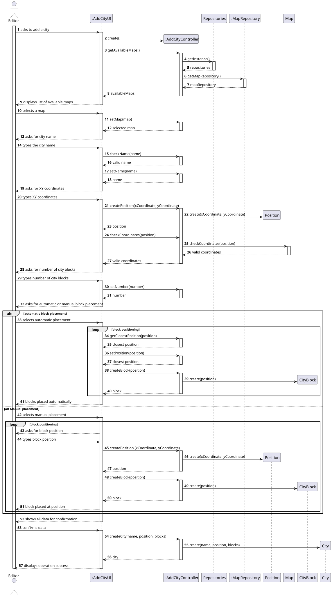
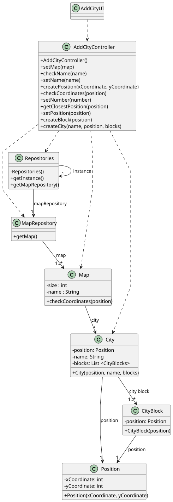

# US003 - Add a City

## 3. Design

### 3.1. Rationale

| Interaction ID | Question: Which class is responsible for...       | Answer            | Justification (with patterns)                                                                          |
|:---------------|:--------------------------------------------------|:------------------|:-------------------------------------------------------------------------------------------------------|
| Step 1         | ... interacting with the actor?                   | AddCityUI         | Pure Fabrication: handles UI responsibilities; not part of Domain Model but supports user interaction. |
|                | ... coordinating the US?                          | AddCityController | Controller: mediates between UI and domain logic.                                                      |
|                | ... knowing the user using the system?            | Editor            | IE: knows its own data (e.g. username, password).                                                      |
| Step 2         | ... knowing all existing maps to show?            | MapRepositories   | IE: Access point to all maps.                                                                          |
| Step 3         | ... saving the selected map?                      | AddCityUI         | IE: Holds working data like selected map.                                                              |
| Step 4         | ... requesting data?                              | AddCityUI         | IE: user interaction is handled at the UI level.                                                       |
| Step 5         | ... instantiating individual city blocks?         | CityBlock         | IE: each block knows its own data and construction logic.                                              |
| Step 6         | ... showing all data and requesting confirmation? | AddCityUI         | IE: user interaction responsibility.                                                                   |
| Step 7         | ... showing all data and requesting confirmation? | AddCityUI         | IE: user interaction responsibility.                                                                   |
| Step 8         | ... instantiating a new City?                     | AddCityController | Creator: already has name, position, blocks — best suited to create a city.                            |
| Step 9         | ... informing operation success?                  | AddCityUI         | IE: UI is responsible for displaying messages to the user.                                             |

### Systematization ##

According to the taken rationale, the conceptual classes promoted to software classes are: 

* Map
* City
* CityBlock
* Position

Other software classes (i.e. Pure Fabrication) identified: 

* AddCityUI
* AddCityController
* Repositories
* MapRepository

## 3.2. Sequence Diagram (SD)

### Full Diagram

This diagram shows the full sequence of interactions between the classes involved in the realization of this user story.

### Split Diagrams

The following diagram shows the same sequence of interactions between the classes involved in the realization of this user story, but it is split in partial diagrams to better illustrate the interactions between the classes.

It uses Interaction Occurrence (a.k.a. Interaction Use).

**Get Task Category List Partial SD**

**Get Task Category Object**

**Get Employee**

**Create Task**

## 3.3. Class Diagram (CD)

