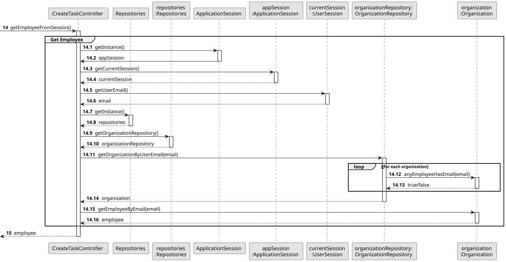
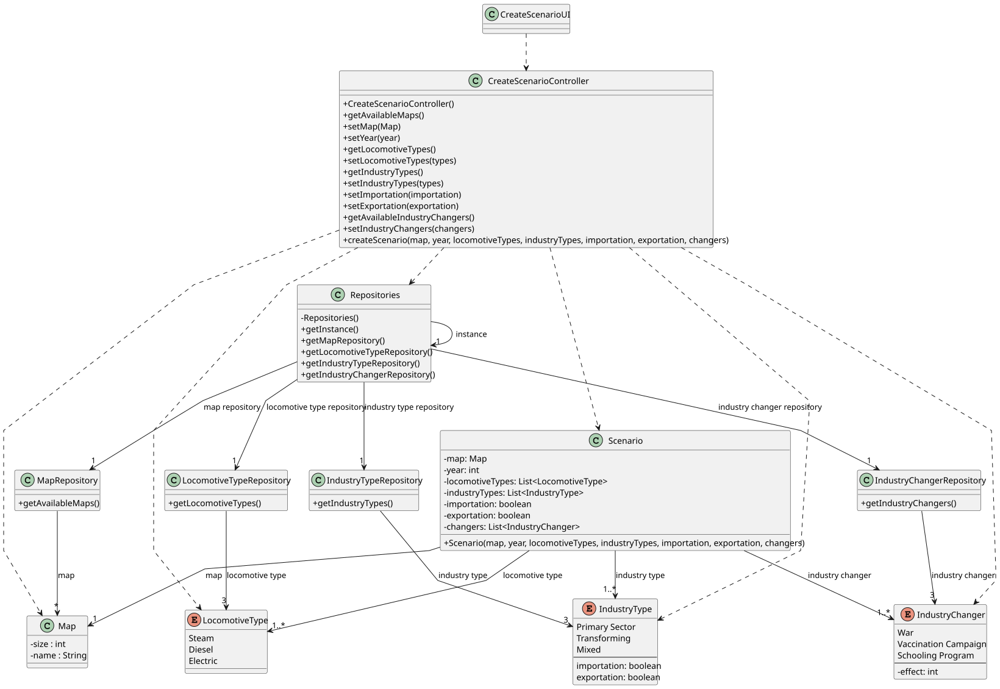

# US004 - Create a scenario

## 3. Design

### 3.1. Rationale

| Interaction ID | Question: Which class is responsible for...                | Answer                    | Justification (with patterns)                                                        |
|----------------|------------------------------------------------------------|---------------------------|--------------------------------------------------------------------------------------|
| Step 1         | ... interacting with the actor?                            | CreateScenarioUI          | Pure Fabrication: UI classes handle user interaction without affecting domain logic. |
|                | ... coordinating the use case?                             | CreateScenarioController  | Controller: Centralizes scenario creation flow, mediates between UI and domain.      |
|                | ... knowing the user using the system?                     | Player                    | IE: knows its own data (e.g. username, password, budget).                            |
| Step 2         | ... knowing all existing maps?                             | MapRepository             | IE: Responsible for managing and providing map data.                                 |
|                | ... accessing all repositories?                            | Repositories              | IE: Provides centralized access to individual repositories.                          |
| Step 3         | ... saving the selected map?                               | CreateScenarioUI          | IE: Maintains map selection as part of the scenario creation flow.                   |
| Step 4         | ... storing the selected year?                             | CreateScenarioUI          | IE: Stores year input from the user until submission.                                |
| Step 5         | ... knowing all available locomotive types?                | LocomotiveTypeRepository  | IE: Provides available locomotive type data.                                         |
| Step 6         | ... saving the selected locomotive types?                  | CreateScenarioUI          | IE: Keeps track of selected types for the scenario configuration.                    |
| Step 7         | ... knowing all available industry types?                  | IndustryTypeRepository    | IE: Knows and provides industry type data.                                           |
| Step 8         | ... saving the selected industry types?                    | CreateScenarioUI          | IE: Stores selected industry types as part of user input.                            |
| Step 9         | ... showing port behavior options?                         | CreateScenarioUI          | IE: UI handles user interaction for selection among predefined options.              |
| Step 10        | ... saving the selected port behavior?                     | CreateScenarioUI          | IE: Temporarily stores the selected port behavior option.                            |
| Step 11        | ... knowing all available industry changers?               | IndustryChangerRepository | IE: Provides data on available industry changers.                                    |
| Step 12        | ... saving the selected industry changers?                 | CreateScenarioUI          | IE: Stores chosen changers before final scenario creation.                           |
| Step 13        | ... showing all selected data and asking for confirmation? | CreateScenarioUI          | IE: Responsible for presenting collected information for final user approval.        |
| Step 14        | ... creating a new scenario instance?                      | Scenario                  | Creator: Scenario class aggregates all configuration data.                           |
|                | ... validating local data (e.g., year, type selection)?    | Scenario                  | IE: Scenario knows and validates its own structure.                                  |
|                | ... validating global consistency (e.g., compatibility)?   | CreateScenarioController  | Controller: Orchestrates validation across domain elements.                          |
|                | ... saving the created scenario?                           | ScenarioRepository        | IE: Dedicated to persisting Scenario entities.                                       |
| Step 15        | ... informing the user of success?                         | CreateScenarioUI          | Pure Fabrication: UI displays success feedback to the actor.                         |

### Systematization ##

According to the taken rationale, the conceptual classes promoted to software classes are: 

* Scenario
* Map
* LocomotiveType
* IndustryType
* IndustryChanger
* PortBehavior

Other software classes (i.e. Pure Fabrication) identified: 

* CreateScenarioUI
* CreateScenarioController
* Repositories
* MapRepository
* LocomotiveTypeRepository
* IndustryTypeRepository
* IndustryChangerRepository
* ScenarioRepository
 

## 3.2. Sequence Diagram (SD)

### Full Diagram

This diagram shows the full sequence of interactions between the classes involved in the realization of this user story.

### Split Diagrams

The following diagram shows the same sequence of interactions between the classes involved in the realization of this user story, but it is split in partial diagrams to better illustrate the interactions between the classes.

It uses Interaction Occurrence (a.k.a. Interaction Use).

**Get Task Category List Partial SD**

**Get Task Category Object**

**Get Employee**

**Create Task**

## 3.3. Class Diagram (CD)

