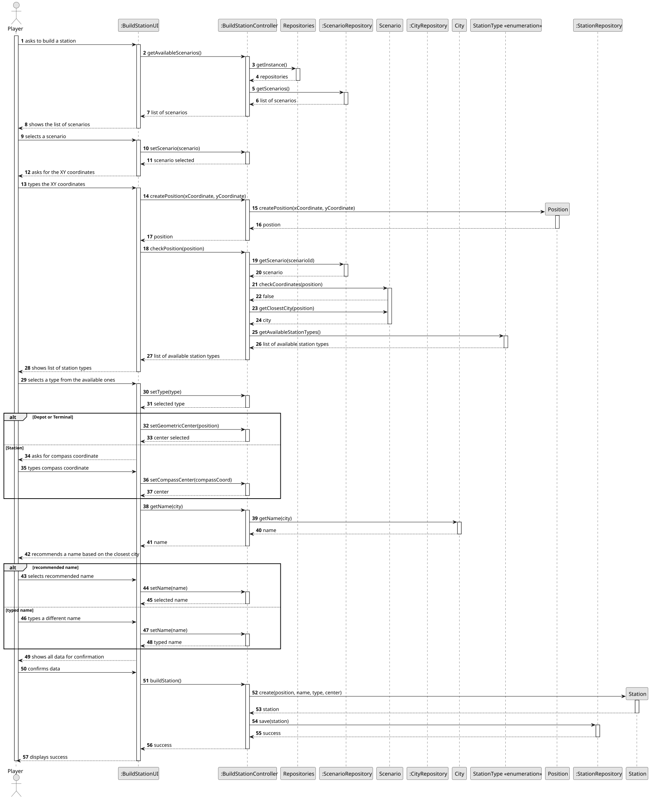
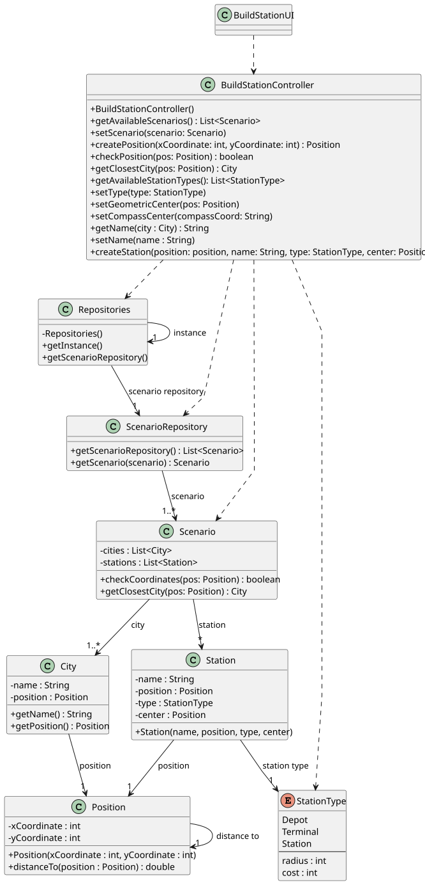

# US005 - Build a station

## 3. Design

### 3.1. Rationale

| Interaction ID | Question: Which class is responsible for...    | Answer                 | Justification (with patterns)                                                         |
|:---------------|:-----------------------------------------------|:-----------------------|:--------------------------------------------------------------------------------------|
| Step 1         | ... interacting with the actor?                | BuildStationUI         | Pure Fabrication: created solely to handle user interaction.                          |
|                | ... coordinating the US?                       | BuildStationController | Controller: central point of control for this use case.                               |
|                | ... knowing the user using the system?         | Player                 | IE: knows its own data (e.g. username, password, budget)                              |
| Step 2         | ... knowing all available scenarios?           | ScenarioRepository     | IE: Responsible for managing persistent access to scenarios.                          |
| Step 3         | ... saving the selected scenario?              | BuildStationUI         | IE: Maintains current state across the flow, including the selected scenario.         |
| Step 4         | ... creating the position?                     | Position               | Creator: encapsulates x and y values and owns their creation.                         |
| Step 5         | ... checking if the position is valid?         | Scenario               | IE: Knows the map and checks if coordinates are occupied.                             |
| Step 6         | ... getting the closest city?                  | Scenario               | IE: Has access to all cities and their positions, can determine proximity.            |
| Step 7         | ... getting the available station types?       | StationType            | IE: Enum containing static list of types with attributes like cost and radius.        |
| Step 8         | ... saving the selected station type?          | BuildStationUI         | IE: Keeps the currently selected type during the interaction.                         |
| Step 9         | ... setting the center if Depot or Terminal?   | BuildStationController | Controller: Applies application logic to interpret UI input for center.               |
| Step 10        | ... setting the compass coordinate if Station? | BuildStationController | Controller: Interprets the compass direction and calculates the position based on it. |
| Step 11        | ... getting the city name?                     | City                   | IE: Owns and returns its own name.                                                    |
| Step 12        | ... suggesting the station name?               | BuildStationUI         | IE: Suggests name based on closest city; encapsulates business rule.                  |
| Step 13        | ... saving the selected name?                  | BuildStationUI         | IE: Keeps the chosen name from either suggestion or user input.                       |
| Step 14        | ... instantiating a new Station?               | BuildStationController | Creator: Has all necessary data (name, type, position, center) to create a Station.   |
|                | ... saving the new station?                    | StationRepository      | IE: Responsible for storing station entities.                                         |
| Step 15        | ... informing the user of operation success?   | BuildStationUI         | Pure Fabrication: Handles user feedback and UI display responsibilities.              |

### Systematization ##

According to the taken rationale, the conceptual classes promoted to software classes are: 

* Scenario
* City
* Station
* StationType
* Position

Other software classes (i.e. Pure Fabrication) identified: 

* BuildStationUI  
* BuildStationController
* Repositories
* ScenarioRepository
* CityRepository
* StationRepository

## 3.2. Sequence Diagram (SD)

### Full Diagram

This diagram shows the full sequence of interactions between the classes involved in the realization of this user story.

## 3.3. Class Diagram (CD)

