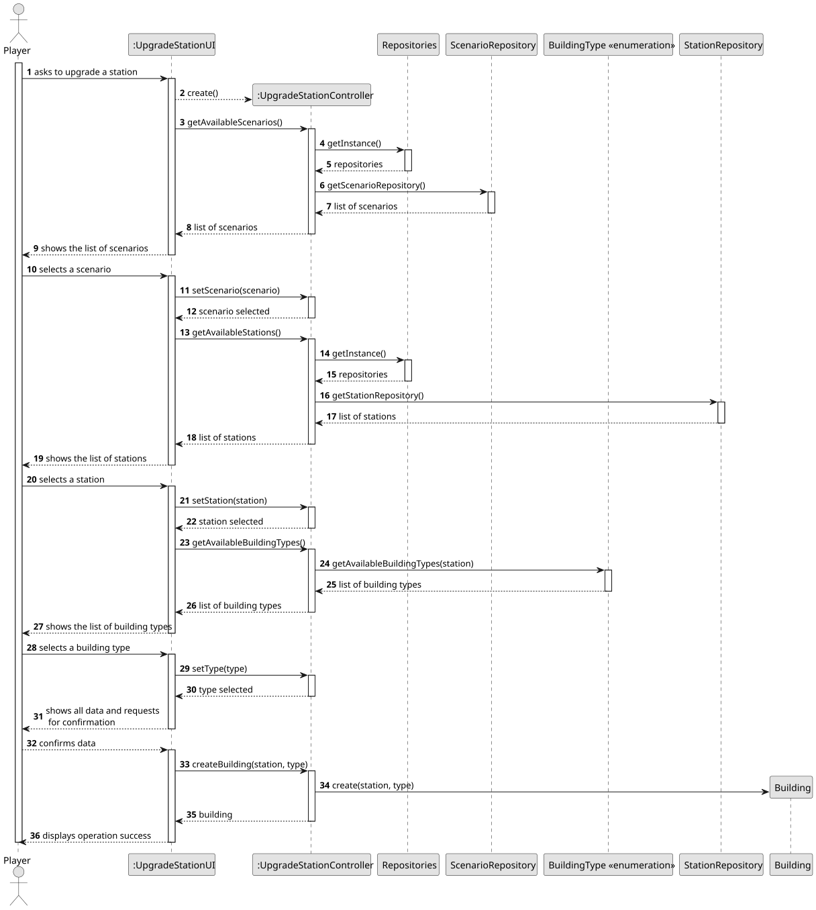
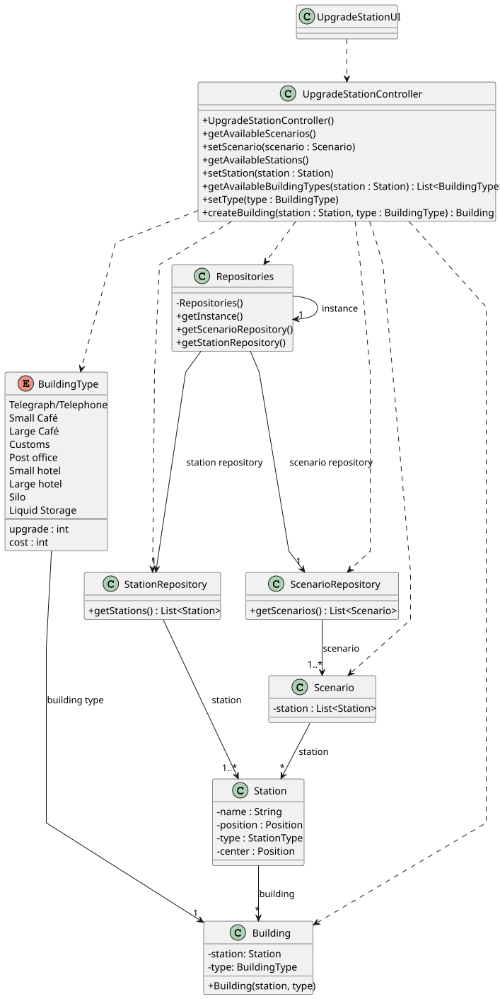

# US006 - Upgrade a station

## 3. Design

### 3.1. Rationale

| Interaction ID | Question: Which class is responsible for...       | Answer                   | Justification (with patterns)                                                    |
|:---------------|:--------------------------------------------------|:-------------------------|:---------------------------------------------------------------------------------|
| Step 1         | ... interacting with the actor?                   | UpgradeStationUI         | Pure Fabrication: created solely to handle user interaction.                     |
|                | ... coordinating the US?                          | UpgradeStationController | Controller: central point of control for this use case.                          |
|                | ... knowing the user using the system?            | Player                   | IE: Knows its own data (e.g. name, current state, etc.).                         |
| Step 2         | ... knowing all available scenarios?              | ScenarioRepository       | IE: Manages access to persisted scenarios.                                       |
| Step 3         | ... saving the selected scenario?                 | UpgradeStationUI         | IE: Keeps the current scenario selected during the flow.                         |
| Step 4         | ... getting available stations?                   | StationRepository        | IE: Responsible for storing and retrieving stations.                             |
| Step 5         | ... saving the selected station?                  | UpgradeStationUI         | IE: Keeps track of which station the player selected.                            |
| Step 6         | ... getting available building types?             | BuildingType             | IE: Enum that defines valid upgrade types.                                       |
| Step 7         | ... saving the selected building type?            | UpgradeStationUI         | IE: Holds selected type to complete the upgrade logic.                           |
| Step 8         | ... showing all data and requesting confirmation? | UpgradeStationUI         | IE: Responsible for presenting collected data and requesting final confirmation. |
| Step 9         | ... instantiating a new Building?                 | UpgradeStationController | Creator: Has all required data (type) to create a new Building.                  |
|                | ... saving the new building?                      | BuildingRepository       | IE: Responsible for saving buildings.                                            |
| Step 10        | ... informing the user of operation success?      | UpgradeStationUI         | IE: Displays confirmation message to the player.                                 |

### Systematization ##

According to the taken rationale, the conceptual classes promoted to software classes are: 

* Scenario
* Station
* Building

Other software classes (i.e. Pure Fabrication) identified: 

* UpgradeStationUI  
* UpgradeStationController
* Repositories
* ScenarioRepository
* StationRepository

## 3.2. Sequence Diagram (SD)

### Full Diagram

This diagram shows the full sequence of interactions between the classes involved in the realization of this user story.

### Split Diagrams

The following diagram shows the same sequence of interactions between the classes involved in the realization of this user story, but it is split in partial diagrams to better illustrate the interactions between the classes.

It uses Interaction Occurrence (a.k.a. Interaction Use).

**Get Task Category List Partial SD**

**Get Task Category Object**

**Get Employee**

**Create Task**

## 3.3. Class Diagram (CD)

