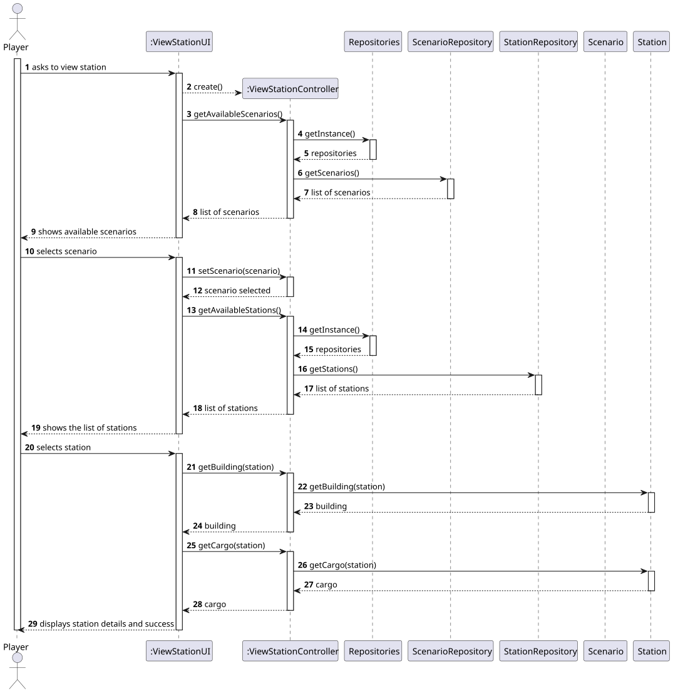
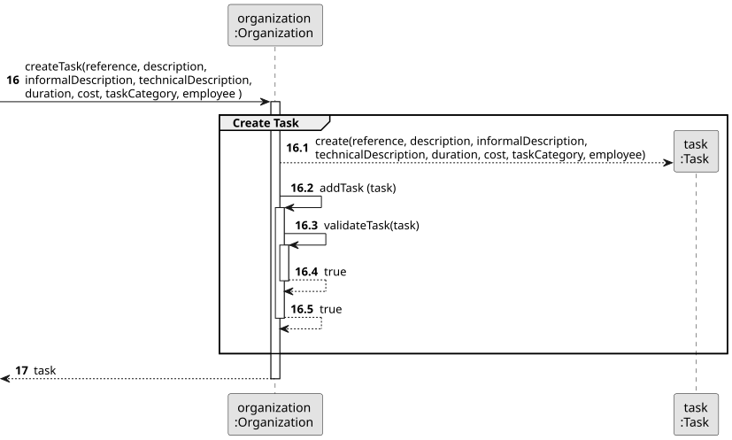
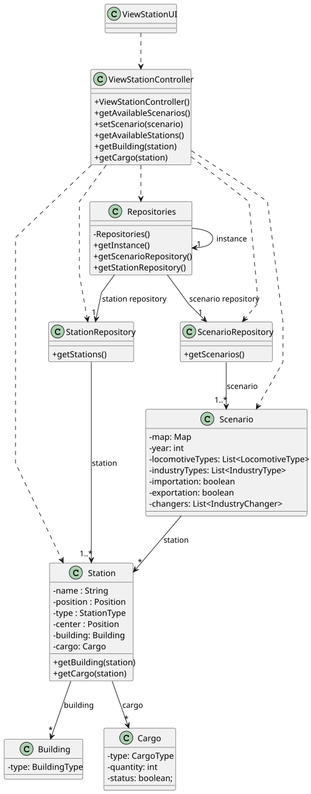

# US007 - View Station Details

## 3. Design

### 3.1. Rationale

| Interaction ID | Question: Which class is responsible for... | Answer                | Justification (with patterns)                                                                    |
|:---------------|:--------------------------------------------|:----------------------|:-------------------------------------------------------------------------------------------------|
| Step 1         | ... interacting with the actor?             | ViewStationUI         | Pure Fabrication: UI is responsible for interfacing with the user; not part of the domain model. |
|                | ... coordinating the US?                    | ViewStationController | Controller: Coordinates the use case by delegating to domain or infrastructure classes.          |
|                | ... knowing the user using the system?      | Player                | IE: Knows its own data (e.g. name, current state, etc.).                                         |
| Step 2         | ... knowing all existing scenarios to show? | ScenarioRepository    | IE: ScenarioRepository stores and provides access to all scenarios.                              |
| Step 3         | ... saving the selected scenario?           | ViewStationUI         | IE: Holds and manages the selected scenario to use in subsequent steps.                          |
| Step 4         | ... knowing all existing stations to show?  | StationRepository     | IE: StationRepository provides access to stations.                                               |
| Step 5         | ... saving the selected station?            | ViewStationUI         | IE: Manages references to objects involved in the current operation.                             |
| Step 6         | ... retrieving station’s building details?  | Station               | IE: Station is the expert on its own structure (i.e., its Building).                             |
|                | ... retrieving station’s cargo?             | Station               | IE: Station knows what cargo it holds.                                                           |
| Step 7         | ... informing operation success?            | ViewStationUI         | IE: UI handles user interaction and is responsible for providing feedback to the user.           |

### Systematization ##

According to the taken rationale, the conceptual classes promoted to software classes are: 

* Scenario
* Station

Other software classes (i.e. Pure Fabrication) identified: 

* ViewStationUI
* ViewStationController
* Repositories
* ScenarioRepository
* StationRepository

## 3.2. Sequence Diagram (SD)

### Full Diagram

This diagram shows the full sequence of interactions between the classes involved in the realization of this user story.

### Split Diagrams

The following diagram shows the same sequence of interactions between the classes involved in the realization of this user story, but it is split in partial diagrams to better illustrate the interactions between the classes.

It uses Interaction Occurrence (a.k.a. Interaction Use).

**Get Task Category List Partial SD**

**Get Task Category Object**

**Get Employee**

**Create Task**

## 3.3. Class Diagram (CD)

