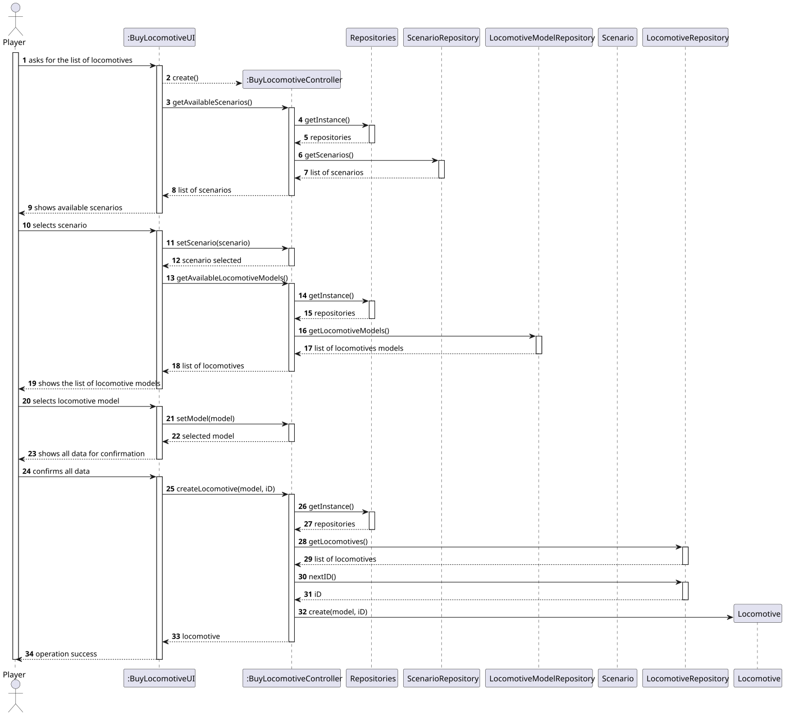
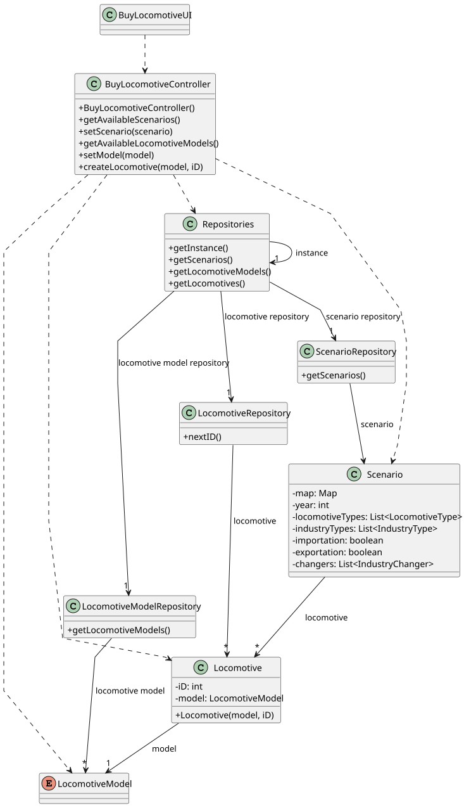

# US009 - Buy A Locomotive

## 3. Design

### 3.1. Rationale

| Interaction ID | Question: Which class is responsible for...            | Answer                    | Justification (with patterns)                                                                    |
|:---------------|:-------------------------------------------------------|:--------------------------|:-------------------------------------------------------------------------------------------------|
| Step 1         | ... interacting with the actor?                        | BuyLocomotiveUI           | Pure Fabrication: Responsible for handling user interaction; not a domain class.                 |
|                | ... coordinating the US?                               | BuyLocomotiveController   | Controller: Centralizes control over the use case flow and interacts with the domain layer.      |
|                | ... knowing the user using the system?                 | Player                    | IE: Knows its own data (e.g. name, current state, etc.).                                         |
| Step 2         | ... knowing all existing locomotive models?            | LocomotiveModelRepository | IE: Specializes in locomotive models.                                                            |
| Step 3         | ... saving the selected model?                         | BuyLocomotiveController   | IE: Keeps track of the selected model as part of the application logic.                          |
| Step 4         | ... requesting data?                                   | BuyLocomotiveUI           | IE: Handles all user-driven requests.                                                            |
| Step 5         | ... saving the inputted data?                          | BuyLocomotiveUI           | IE: Stores selections to be used when creating the locomotive.                                   |
| Step 6         | ... showing all data and requesting confirmation?      | BuyLocomotiveUI           | IE: All UI interactions are the responsibility of this class.                                    |
| Step 7         | ... instantiating a new Locomotive?                    | BuyLocomotiveController   | Creator: Has access to the required data (model, id), and logically coordinates object creation. |
| Step 8         | ... validating all data (local validation)?            | Locomotive                | IE: Owns the data (id and model)                                                                 |
| Step 9         | ... saving the created locomotive?                     | LocomotiveRepository      | IE: Repository owns all locomotives and generates new IDs (suggesting it also stores them).      |
| Step 10        | ... informing operation success?                       | BuyLocomotiveUI           | IE: In charge of communicating results to the user.                                              |

### Systematization ##

According to the taken rationale, the conceptual classes promoted to software classes are: 

* Scenario
* Locomotive
* LocomotiveModel

Other software classes (i.e. Pure Fabrication) identified: 

* BuyLocomotiveUI
* BuyLocomotiveController
* Repositories
* ScenarioRepository
* LocomotiveModelRepository
* LocomotiveRepository

## 3.2. Sequence Diagram (SD)

### Full Diagram

This diagram shows the full sequence of interactions between the classes involved in the realization of this user story.

### Split Diagrams

The following diagram shows the same sequence of interactions between the classes involved in the realization of this user story, but it is split in partial diagrams to better illustrate the interactions between the classes.

It uses Interaction Occurrence (a.k.a. Interaction Use).

**Get Task Category List Partial SD**

**Get Task Category Object**

**Get Employee**

**Create Task**

## 3.3. Class Diagram (CD)

