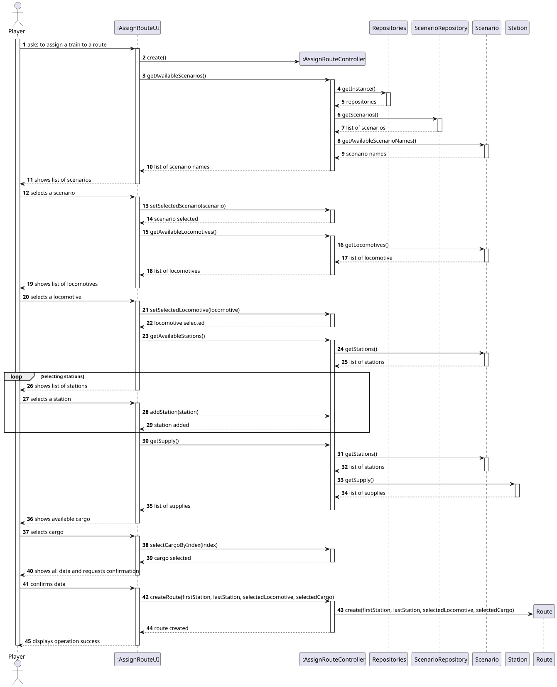
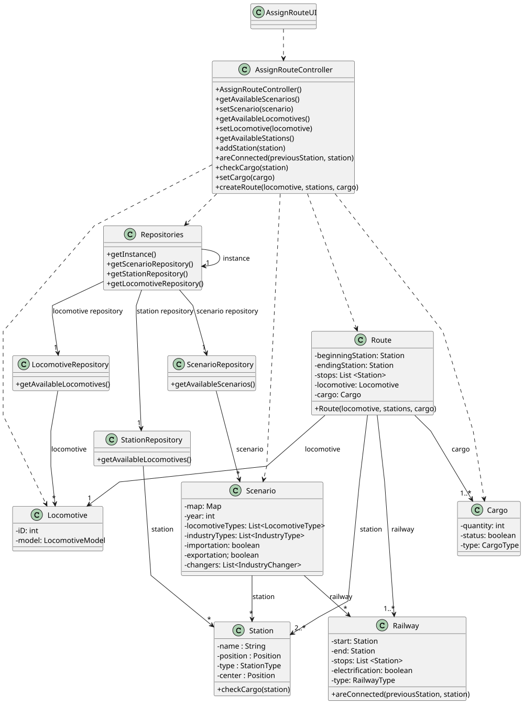

# US010 - Route Selection

## 3. Design

### 3.1. Rationale

| Interaction ID | Question: Which class is responsible for...       | Answer                | Justification (with patterns)                                                                                       |
|:---------------|:--------------------------------------------------|:----------------------|:--------------------------------------------------------------------------------------------------------------------|
| Step 1         | ... interacting with the actor?                   | AssignRouteUI         | Pure Fabrication: UI classes handle user interaction without polluting domain classes.                              |
|                | ... coordinating the use case?                    | AssignRouteController | Controller: Centralizes control and mediates between UI and domain logic.                                           |
|                | ... knowing the user using the system?            | Player                | IE: knows its own data (e.g. username, password, budget).                                                           |
| Step 2         | ... knowing all existing scenarios?               | ScenarioRepository    | IE: Responsible for providing access to scenario data.                                                              |
|                | ... accessing repositories?                       | Repositories          | IE: Provides access to various repository instances.                                                                |
| Step 3         | ... saving the selected scenario?                 | AssignRouteUI         | IE: Maintains the chosen scenario as part of route assignment context.                                              |
| Step 4         | ... knowing all available locomotives?            | LocomotiveRepository  | IE: Knows and provides locomotive data.                                                                             |
| Step 5         | ... saving the selected locomotive?               | AssignRouteUI         | IE: Stores the user-selected locomotive.                                                                            |
| Step 6         | ... knowing all available stations?               | StationRepository     | IE: Responsible for managing station data.                                                                          |
| Step 7         | ... saving the selected stations (for the route)? | AssignRouteUI         | IE: Accumulates the stations chosen for the route.                                                                  |
| Step 8         | ... validating station connection?                | Scenario              | IE: Scenario knows its own structure and constraints (e.g., connections between stations).                          |
| Step 9         | ... checking the available cargo at a station?    | Station               | IE: A station knows what cargo it has available.                                                                    |
| Step 10        | ... saving the selected cargo?                    | AssignRouteUI         | IE: Stores selected cargo to associate it with the final route.                                                     |
| Step 11        | ... showing all data and requesting confirmation? | AssignRouteUI         | Pure Fabrication: UI manages user interaction and confirmation.                                                     |
| Step 12        | ... instantiating a new Route?                    | Route                 | Creator: Owns the relevant data (locomotive, cargo, list of stations).                                              |
|                | ... saving the created Route?                     | AssignRouteController | IE: May store or forward the created route; persistence logic not shown, assumed to be mediated via the controller. |
| Step 13        | ... informing operation success?                  | AssignRouteUI         | Pure Fabrication: UI handles final feedback to the user.                                                            |

### Systematization ##

According to the taken rationale, the conceptual classes promoted to software classes are: 

* Scenario
* Station
* Route
* Locomotive

Other software classes (i.e. Pure Fabrication) identified: 

* AssignRouteUI
* AssignRouteController
* Repositories
* ScenarioRepository
* StationRepository
* LocomotiveRepository

## 3.2. Sequence Diagram (SD)

### Full Diagram

This diagram shows the full sequence of interactions between the classes involved in the realization of this user story.

### Split Diagrams

The following diagram shows the same sequence of interactions between the classes involved in the realization of this user story, but it is split in partial diagrams to better illustrate the interactions between the classes.

It uses Interaction Occurrence (a.k.a. Interaction Use).

**Get Task Category List Partial SD**

**Get Task Category Object**

**Get Employee**

**Create Task**

## 3.3. Class Diagram (CD)

