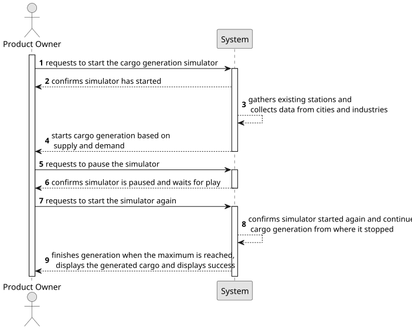

# US012 - Simulate Cargo Generation

## 1. Requirements Engineering

### 1.1. User Story Description

As a Player, I want to create a simulator that generates
cargoes at current stations, automatically, considering the cities and
industries that the railway network serves.

### 1.2. Customer Specifications and Clarifications 

**From the specifications document:**

>As a user with the Player role, I should be able to start a simulation of cargo. This simulation consists in gathering information, such as the cities and industries available for cargo generation covered by the railway and the stations where the cargo should appear, and simulate at user command with the start and pause input.
 

**From the client clarifications:**

> **Question**: "Is the simulation run map by map or for all existing maps?
Example: You choose to run the simulation alone on the Lisbon city map but not on the Paris map. Or would you necessarily have to run it on all the maps?
If it's map by map, how does that work? Does it run on the map the Product Owner is on? Does the Product Owner select which maps he wants to run the simulation on?"
> 
> **Answer**: "In the context of simulation, the player chooses a scenario to play, and a map must be associated with the scenario."

> **Question**: "When the Product Owner pauses is this pause local to a specific scenario or to all scenarios? Is this pause for one map or for all?"
>
> **Answer**: "Running the simulator for a scenario is called a simulation."

> **Question**: "Should the simulator run in real-time or in set intervals?"
> 
> **Answer**: "Not in real-time."

> **Question**: "Can users manually adjust cargo generation rates?"
>
> **Answer**: "Maybe not the Player but generation should be configurable (maybe in a config file)."

> **Question**: "Should cargo generation be influenced by train schedules?"
>
> **Answer**: "There are no train schedules!"

> **Question**: "Is there a limit to cargo storage?"
> 
> **Answer**: "24."
 
> **Question**: "How should cargo generation be done? At fixed time intervals or based on specific events (train arrival)?"
>
> **Answer**: "Accordingly to the frequency defined for the industry and house blocks by the station (the distribution along the year can be fixed or random)."

### 1.3. Acceptance Criteria

* **AC1:** This simulator should provide options for start/pause.

### 1.4. Found out Dependencies

* There is a dependency on US005 as at least one station must exist to generate cargo.

### 1.5 Input and Output Data

**Input Data:**

* Typed data:
    * the request
    * a start command
    * a pause command
	
* Selected data:
    * a scenario 

**Output Data:**

* List of available scenarios
* Simulation status (running/paused)
* Generated cargo 
* (In)Success of the operation

### 1.6. System Sequence Diagram (SSD)

**_Other alternatives might exist._**

### 1.7 Other Relevant Remarks

