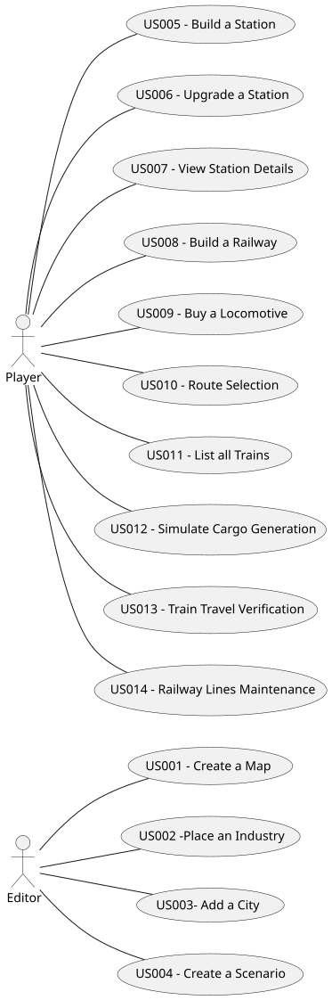

# Use Case Diagram (UCD)

# Use Cases / User Stories

| UC/US | Description                                              |                   
|:------|:---------------------------------------------------------|
| US001 | [Create a Map](../../US001/US001-README.md)              |
| US002 | [Place an Industry](../../US002/US002-README.md)         |
| US003 | [Add a City](../../US003/US003-README.md)                |
| US004 | [Create a Scenario](../../US004/US004-README.md)         |
| US005 | [Build a Station](../../US005/US005-README.md)           |
| US006 | [Upgrade a Station](../../US006/US006-README.md)         |
| US007 | [View Station Details](../../US007/US007-README.md)      |
| US008 | [Build a Railway between Stations]()                     |
| US009 | [Buy a Locomotive](../../US009/US009-README.md)          |
| US010 | [Route Selection](../../US010/US010-README.md)           |
| US011 | [List all Trains]()           |
| US012 | [Simulate Cargo Generation](../../US012/US012-README.md) |
| US013 | [Train Route Verification](../../US013/US013-README.md)  |
| US014 | [Railway Lines Maintenance](../../US014/US014-README.md) |

