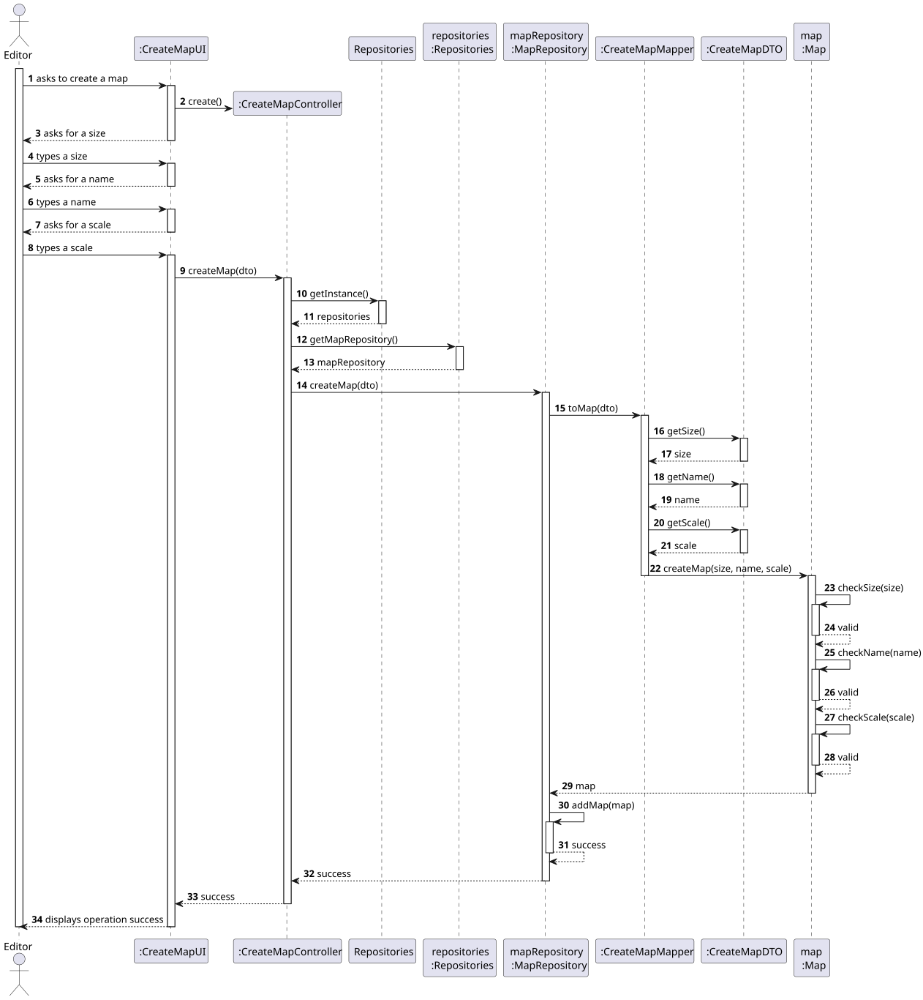
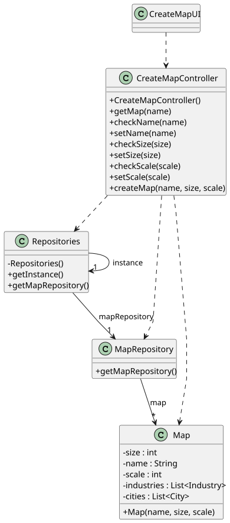

# US001 - Create a Map

## 3. Design

### 3.1. Rationale

| Interaction ID | Question: Which class is responsible for...           | Answer              | Justification (with patterns)                                                                                                                                                             |
|----------------|-------------------------------------------------------|---------------------|-------------------------------------------------------------------------------------------------------------------------------------------------------------------------------------------|
| Step 1         | ... interacting with the actor?                       | CreateMapUI         | **Pure Fabrication**: Handles user interaction but is not part of domain;  **Low Coupling**: UI is decoupled from domain.                                                              |
|                | ... coordinating the US?                              | CreateMapController | **Controller**: Manages the flow of the use case;  **High Cohesion**: Centralizes responsibilities related to map creation.                                                            |
|                | ... knowing the user using the system?                | Editor              | **Information Expert**: Holds knowledge about itself (username, password).                                                                                                                |
| Step 2         | ... requesting the map name and size?                 | CreateMapUI         | **Information Expert**: Manages interaction logic;  **High Cohesion**: All input-related logic kept in UI.                                                                             |
| Step 3         | ... saving the inputted map data (name and size)?     | CreateMapDTO        | **Pure Fabrication**: DTO is not domain, used for data transport;  **Low Coupling**: Decouples UI and domain.                                                                          |
| Step 4         | ... confirming user input and submitting the request? | CreateMapUI         | **Information Expert**: Has full control over data flow to controller;  **High Cohesion**: Manages all user input flow.                                                                |
| Step 5         | ... checking if a map name already exists?            | MapRepository       | **Information Expert**: Owns knowledge of stored maps;  **Protected Variation**: Accessed through interface.                                                                           |
| Step 6         | ... creating a new Map?                               | CreateMapMapper     | **Creator**: Responsible for creating Map objects from DTOs;  **Pure Fabrication**: Decouples transformation logic;  **Low Coupling**: Keeps controller free of construction logic. |
| Step 7         | ... saving the newly created Map?                     | MapRepository       | **Information Expert**: Manages domain persistence;  **Protected Variation**: Insulates controller from storage logic.                                                                 |
| Step 8         | ... informing operation success?                      | CreateMapUI         | **Information Expert**: Knows how to present status to the user;  **High Cohesion**: Consolidates all user-facing actions.                                                             |

### Systematization ##

According to the taken rationale, the conceptual classes promoted to software classes are: 

* Map

Other software classes (i.e. Pure Fabrication) identified: 

* CreateMapUI
* CreateMapController
* CreateMapMapper
* CreateMapDTO
* Repositories
* MapRepository

## 3.2. Sequence Diagram (SD)

### Full Diagram

This diagram shows the full sequence of interactions between the classes involved in the realization of this user story.

## 3.3. Class Diagram (CD)

