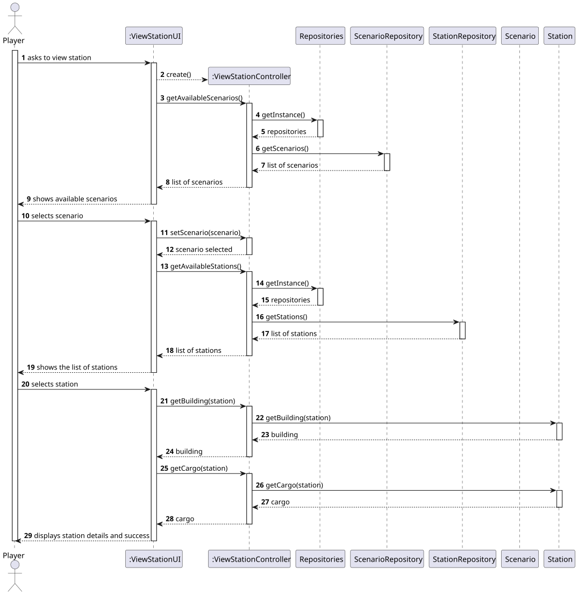
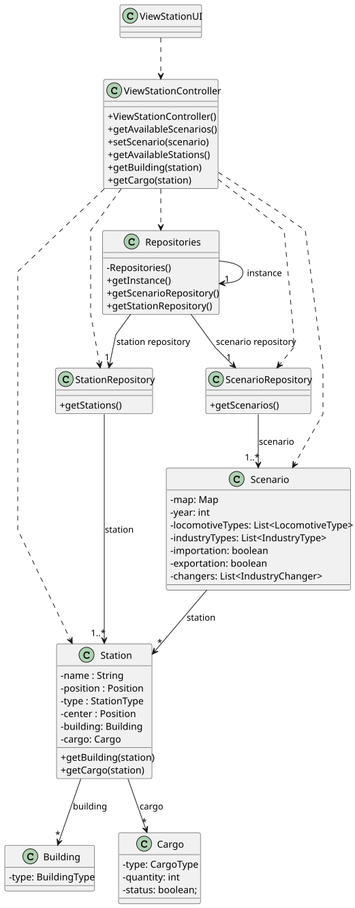

# US007 - View Station Details

## 3. Design

### 3.1. Rationale

| **Interaction ID** | **Question: Which class is responsible for...**                  | **Answer**                                 | **Justification (with patterns)**                                                      |
|--------------------|------------------------------------------------------------------|--------------------------------------------|----------------------------------------------------------------------------------------|
| 1–4                | Handling user input and initiating the use case                  | `:ViewStationDetailsUI`                    | **Controller (UI Layer)** – Captures input and drives the interaction with the player. |
| 5–23               | Coordinating scenario retrieval and sending scenario names to UI | `:ViewStationDetailsController`            | **Controller** – Manages use case logic and repository access.                         |
| 6, 12              | Providing singleton access to repositories                       | `Repositories`                             | **Pure Fabrication (Singleton)** – Provides access to repositories.                    |
| 8                  | Accessing list of scenarios                                      | `ScenarioRepository`                       | **Information Expert** – Knows how to retrieve Scenario objects.                       |
| 9–21               | Mapping Scenarios to DTOs                                        | `ScenarioListMapper`                       | **Pure Fabrication** – Converts domain objects to UI-ready DTOs.                       |
| 24–26              | Handling user selection of a scenario                            | `:ViewStationDetailsUI`                    | **Controller (UI Layer)** – Captures scenario selection.                               |
| 27–53              | Coordinating station retrieval and sending station names to UI   | `:ViewStationDetailsController`            | **Controller** – Retrieves and maps station data.                                      |
| 29, 35             | Accessing Station repository                                     | `Repositories`, `StationRepository`        | **Pure Fabrication** and **Information Expert** – Provides access to station data.     |
| 36–50              | Mapping Stations to DTOs                                         | `StationListMapper`                        | **Pure Fabrication** – Transforms domain to DTO.                                       |
| 54–55              | Handling player’s station selection                              | `:ViewStationDetailsUI`                    | **Controller (UI Layer)** – Handles player interaction.                                |
| 56–60              | Retrieving and returning building details                        | `:ViewStationDetailsController`, `Station` | **Controller** + **Information Expert** – Station knows its buildings.                 |
| 61–65              | Retrieving and returning cargo details                           | `:ViewStationDetailsController`, `Station` | **Controller** + **Information Expert** – Station knows its cargo.                     |
| 66                 | Displaying full station details                                  | `:ViewStationDetailsUI`                    | **Controller (UI Layer)** – Presents results to the player.                            |

### Systematization ##

According to the taken rationale, the conceptual classes promoted to software classes are: 

* Scenario
* Station
* Player

Other software classes (i.e. Pure Fabrication) identified: 

* ViewStationUI
* ViewStationController
* Repositories
* ScenarioRepository
* StationRepository
* ScenarioListMapper
* StationListMapper
* ScenarioDTO
* StationDTO

## 3.2. Sequence Diagram (SD)

### Full Diagram

This diagram shows the full sequence of interactions between the classes involved in the realization of this user story.

## 3.3. Class Diagram (CD)

