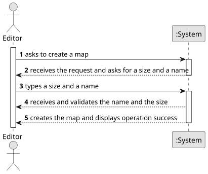

# US001 - Create a Map

## 1. Requirements Engineering

### 1.1. User Story Description

As an Editor, I want to create a map with a size and a name.

### 1.2. Customer Specifications and Clarifications 
**From the specifications document:**

> As a user with the Editor role, I should be able to create a map, which needs to include a name and a size. For the size, there is an imposed, lower and upper limit which it may obey in its dimensions. As for the name, it is free of choice, however the language should be appropriate.

**From the client clarifications:**
>

### 1.3. Acceptance Criteria

There is no acceptance criteria for this user story.

### 1.4. Found out Dependencies

There are no dependencies in this user story.

### 1.5 Input and Output Data

**Input Data:**

* Typed data:
    * a size
    * a name

**Output Data:**

* (In)Success of the operation

### 1.6. System Sequence Diagram (SSD)

**_Other alternatives might exist._**

### 1.7 Other Relevant Remarks

Nothing as of right now.
