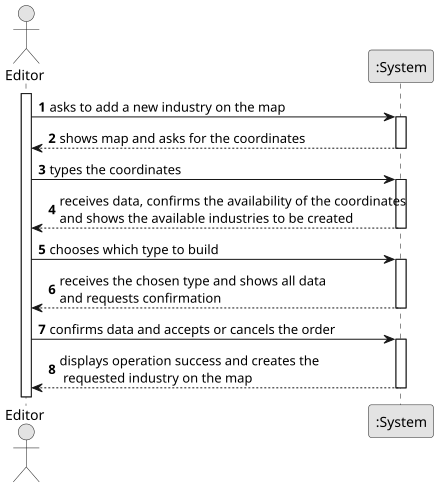

# US002 - Place an Industry

## 1. Requirements Engineering

### 1.1. User Story Description

As an Editor, I want to add an industry in a position XY of the selected map.

### 1.2. Customer Specifications and Clarifications 

**From the specifications document:**

> As an user with the Editor role, I should be able to create an industry in a certain map, with user given coordinates and type. To do so, coordinates need to be declared by the user and then the type of industry needs to be selected, chosen from the available ones.

### 1.3. Acceptance Criteria

* None

### 1.4. Found out Dependencies

* There is a dependency on US01, as it needs a map to be available for the industry to be placed on.

### 1.5 Input and Output Data

**Input Data:**

* Typed data:
    * a coordinate
	
* Selected data:
    * a type of industry

**Output Data:**

* (In)Success of the operation
* The placement of the industry on the grid

### 1.6. System Sequence Diagram (SSD)

**_Other alternatives might exist._**

### 1.7 Other Relevant Remarks

* None