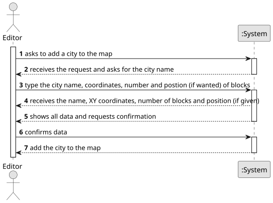

# US003 - Add City to the Map

## 1. Requirements Engineering

### 1.1. User Story Description

As an Editor, I want to add a city in a position XY of the selected map, with a name and a positive number of house blocks.

### 1.2. Customer Specifications and Clarifications 

**From the specifications document:**

>	An Editor wants to change the map adding a city. To do this, the Editor must add all the city information (name, position and number of blocks). The data must follow some rules like: the cty cannot have special characters and digits; the house blocks can be assigned manually or automatically. 

### 1.3. Acceptance Criteria

* **AC1:** A city name cannot have special characters or digits.
* **AC2:** The house blocks can be assigned manually or automatically (randomly around the city tag position).

### 1.4. Found out Dependencies

* There is a dependency on "US003 - Add City to the Map" as there must be a map already created

### 1.5 Input and Output Data

**Input Data:**

* Typed data:
    * a city name
    * a position (X,Y)
    * a positive number of blocks

**Output Data:**

* City added to the map
* (In)Success of the operation

### 1.6. System Sequence Diagram (SSD)

**_Other alternatives might exist._**

### 1.7 Other Relevant Remarks

* Nothing to say.