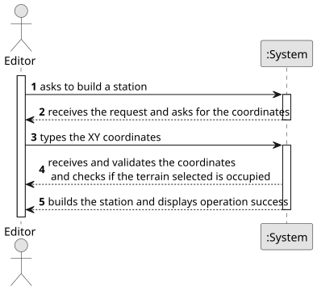

# US005 - Build a station 

## 1. Requirements Engineering

### 1.1. User Story Description

As a Player, I want to build a station

### 1.2. Customer Specifications and Clarifications 

**From the specifications document:**

> As a user with the Player role, I should be able to create a new station on the map. However, it must be checked whether the chosen location is occupied with other building, avoiding Overbuilding.

**From the client clarifications:**

### 1.3. Acceptance Criteria

* **AC1:** Overbuilding is not possible.

### 1.4. Found out Dependencies

* There is a dependency on "US001 - Create a Map" as there needs to be a map already created and on "US002 - Place an industry" and "US003- Add a City" as there can be a city or and industry already built in the wanted location.

### 1.5 Input and Output Data

**Input Data:**

* Typed data:
    * station building request;
    * coordinates;

**Output Data:**

* (In)Success of the operation

### 1.6. System Sequence Diagram (SSD)

**_Other alternatives might exist._**

### 1.7 Other Relevant Remarks

* None at the moment