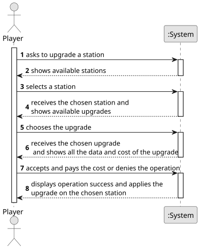

# US006 - Upgrade a station

## 1. Requirements Engineering

### 1.1. User Story Description

As a Player, I want to upgrade a selected station with a building.

### 1.2. Customer Specifications and Clarifications 

>As an user with the Player role, I should be able to upgrade an existing station, adding a building to it. To do so, a station must be selected as well as the type of building wanted. 

### 1.3. Acceptance Criteria

+ Each type of station improvement has a date from which it is available.
  
+ Some equipments are mutually exclusive (e.g., small and grand hotel)
  and some equipments/buildings replace others (the telegraph was initially used to facilitate the operation of trains at stations, and was later
  replaced by the telephone, so after the advent of telephone, telegraph is no more available).

### 1.4. Found out Dependencies

* There is a dependency on "US005 - Build a station" as there must be at least one station to upgrade.

### 1.5 Input and Output Data

**Input Data:**

* Typed data:
	
* Selected data:
    * the station
    * the upgrade

**Output Data:**

* List of existing stations
* List of available upgrades
* (In)Success of the operation

### 1.6. System Sequence Diagram (SSD)

**_Other alternatives might exist._**

### 1.7 Other Relevant Remarks
