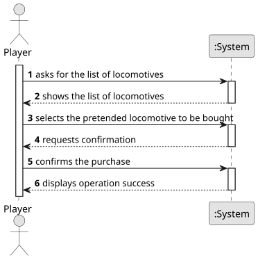

# US009 - Buy A Train

## 1. Requirements Engineering

### 1.1. User Story Description

As a Player, I want to buy a train.

### 1.2. Customer Specifications and Clarifications 

**From the specifications document:**

>	The Player wants to buy a train which he must choose the locomotive from a list of locomotives that are available for the scenario as well as a current date 

**From the client clarifications:**

### 1.3. Acceptance Criteria

* **AC1:** The player should choose the locomotive from a list of available locomotives for the scenario as well as a current date."

### 1.4. Found out Dependencies

* There is a dependency on "US009 - Buy A Train" as there must be a list of locomotives already created.

### 1.5 Input and Output Data

**Input Data:**

* Asks for the list of locomotives available to buy
* Bought locomotive

**Output Data:**

* List of locomotives available to buy
* (In)Success of the operation

### 1.6. System Sequence Diagram (SSD)

**_Other alternatives might exist._**

### 1.7 Other Relevant Remarks

* The created task stays in a "not published" state in order to distinguish from "published" tasks.