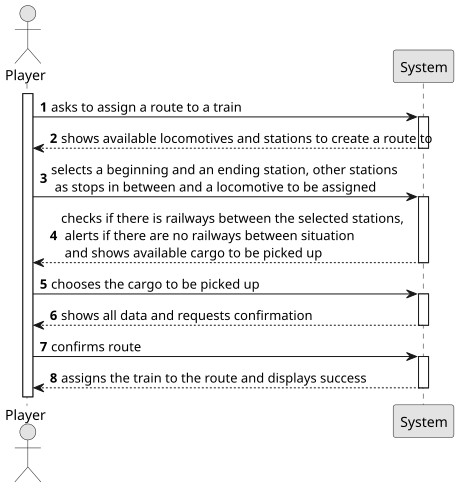

# US010 - Route Selection

## 1. Requirements Engineering

### 1.1. User Story Description

As a Player, I want to assign a selected train to a route with a
valid station and the respective list of cargoes to be picked up

### 1.2. Customer Specifications and Clarifications 

**From the specifications document:**

As an user with the Player role, I should be able to choose a train from the list and assign in to a route. This route should include a valid station as a stop for the train. In the station, there should be a list of cargoes to be picked up by the train.

**From the client clarifications:**

> None

### 1.3. Acceptance Criteria

* None

### 1.4. Found out Dependencies

* There is an inherent dependency in almost all other us's, as this one needs, at least 2 stations 
 a train and a route to exist so that it can be run.

### 1.5 Input and Output Data

**Input Data:**

* Typed data:
	
* Selected data:
    * a train
    * a route
    * a station
    * List of cargoes to be picked up

**Output Data:**

* Success or failure of the operation
* ETA - Estimated time of arrival

### 1.6. System Sequence Diagram (SSD)

**_Other alternatives might exist._**

### 1.7 Other Relevant Remarks

* No other relevant remarks