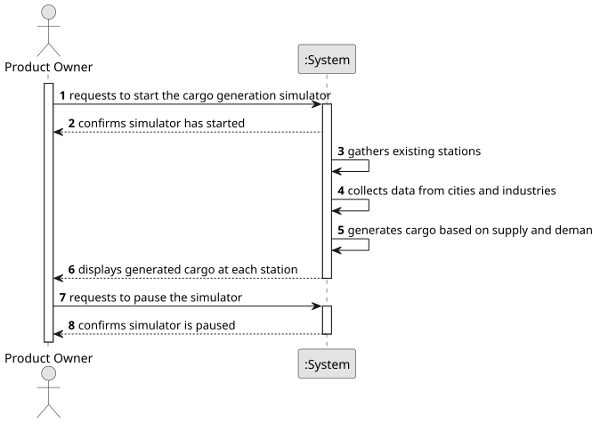

# US012 - Create a simulator that generates cargos

## 1. Requirements Engineering

### 1.1. User Story Description

As a Product Owner, I want to create a simulator that generates
cargoes at current stations, automatically, considering the cities and
industries that the railway network serves. AC1: This simulator should
provide options for start/pause.

### 1.2. Customer Specifications and Clarifications 

**From the specifications document:**
 

**From the client clarifications:**

### 1.3. Acceptance Criteria

* **AC1:** All required fields must be filled in.
* **AC2:** This simulator should provide options for start/pause.
* **AC3:** Cargo generation must consider the cities and industries present on the map
### 1.4. Found out Dependencies

* There is a dependency on "US005 - Build a station" as at least one station must exist to generate cargo.
### 1.5 Input and Output Data

**Input Data:**

* Typed data:
  * Simulation start command
  * Simulation pause command
	
* Selected data:
    * Existing cities and their respective cargo demands
    * Existing industries and their respective cargo production
    * Stations where cargo can be generated
    * Available railway network structure (connections between stations)

**Output Data:**

* Cargo generated at each station, based on nearby cities and industries
* Updated station storage reflecting newly generated cargo
* Real-time status of the simulation (running/paused)
* Logs of generated cargo and its corresponding origin points

### 1.6. System Sequence Diagram (SSD)

**_Other alternatives might exist._**

### 1.7 Other Relevant Remarks

* The created task remains in a "not published" state until it is explicitly published.
* The simulator should operate within the defined railway network context, ensuring that cargo is generated according to the capacities of stations and the demands of industries and cities.